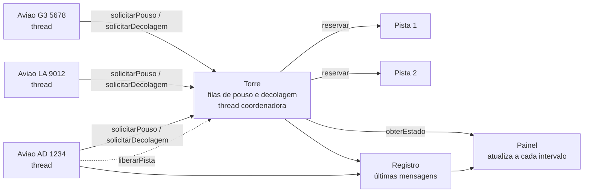

# Simulador de Aeroporto (Java)

Projeto de Concorrência da 2ª VA de Paradigmas de Programação (UFRPE).
Simulador em tempo real de um aeroporto pequeno, com saída animada no terminal.

**Equipe:** Antonio Neto (Pessoa A) e Guilherme Augusto (Pessoa B)

## Como executar

Requisito: JDK 17 ou superior.

```bash
./rodar.sh                        # usa config/C1.properties
./rodar.sh config/C2.properties   # 4 aviões para pousar, 1 pista
```

No Windows: `rodar.bat` (ou `rodar.bat config\C2.properties`).

O programa roda com `java -ea`, que ativa as asserções (`assert`).

## Arquivo de configuração

Arquivos em `config/`. Parâmetros (tempos em milissegundos):

| Parâmetro | Significado |
|---|---|
| `avioesParaPousar` | aviões que começam no ar pedindo pouso |
| `avioesParaDecolar` | aviões que começam no solo pedindo decolagem |
| `pistas` | número de pistas |
| `tempoOperacaoMs` | duração de um pouso ou decolagem |
| `delayAposPousoMs` | tempo entre o pouso e o próximo pedido (decolagem) |
| `delayAposDecolagemMs` | tempo entre a decolagem e o próximo pedido (pouso) |
| `intervaloPainelMs` | taxa de atualização do painel |
| `limparTela` | limpa o terminal a cada atualização |

## Arquitetura



## Principais partes

- **Aviao** (`Aviao.java`): thread com ciclo infinito (pede pouso, pousa, espera, pede decolagem, decola, espera, repete). Só conversa com a Torre.
- **Torre** (`Torre.java`): coordenadora central. Mantém as filas de pouso e decolagem, escolhe o próximo pedido (pouso tem prioridade), procura uma pista livre e concede a autorização.
- **Pista** (`Pista.java`): recurso de acesso exclusivo. Detecta violações e lança `ConflitoDePistaException`.
- **Painel** (`Painel.java`): mostra pistas, filas e últimas mensagens no terminal, no intervalo configurado.
- **Registro** (`Registro.java`): mural de mensagens compartilhado (thread-safe).
- **Configuracao** (`Configuracao.java`): lê o arquivo `.properties`.

## Controle de concorrência

_(Antonio: explicar aqui os mecanismos usados e justificar a escolha.)_

Mecanismos usados na versão inicial:

- `ReentrantLock` + `Condition` na Torre: protegem as filas e o estado das pistas; a thread da Torre espera em `haTrabalho.await()` quando não há pedido ou pista livre.
- `CompletableFuture` em cada pedido: o avião bloqueia em `get()` até a Torre conceder a autorização.
- `AtomicReference` com `compareAndSet` na Pista: a reserva é atômica e detecta qualquer ocupação indevida.

## Exceções e como provocá-las

`ConflitoDePistaException` é lançada pela Pista quando alguém tenta ocupar uma pista já ocupada (ou liberar uma pista que não é sua). A mensagem informa a pista e os aviões envolvidos.

**Para desativar o controle e ver a exceção:** em `Torre.java`, método `buscarPistaLivre`, linha 172, troque

```java
if (pista.estaLivre()) {
```

por

```java
if (true) {
```

A Torre passa a autorizar aviões em pistas ocupadas e a exceção aparece no painel e no terminal. Use a configuração C2 (1 pista) para ver o efeito logo.

## Asserções

| Onde | Condição verificada | Pessoa |
|---|---|---|
| `Torre.autorizarProximo` | a pista reservada pertence ao avião autorizado | A |
| `Aviao.pousar` / `Aviao.decolar` | o avião só usa a pista depois de autorizado pela Torre | B |

## Divisão do trabalho

- **Pessoa A (Antonio Neto):** Pista, Torre, sincronização, exceções, documentação do controle de concorrência.
- **Pessoa B (Guilherme Augusto):** Aviao, Configuracao, Painel, Principal, README.

## Código existente e uso de IA generativa

- **Código existente:** nenhum código de terceiros foi copiado.
- **IA generativa:** O apoio durante o desenvolvimento do trabalho, auxiliando na organização e divisão das tarefas, na revisão dos códigos implementados e no aprimoramento dos comentários presentes no código, buscando torná-los mais claros, objetivos e compreensíveis  foi gerada com o **Claude (Anthropic), modelo Claude Sonnet 5.5**